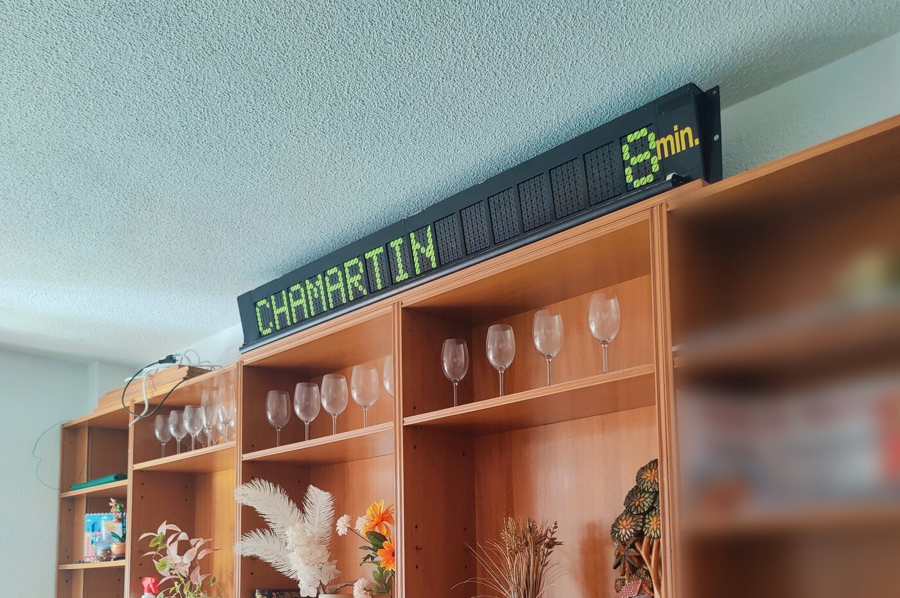
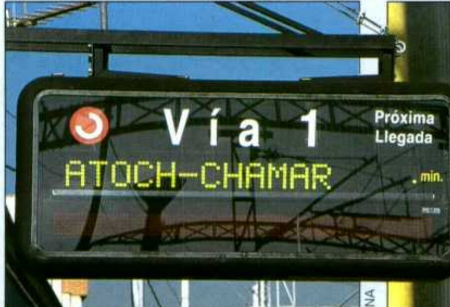
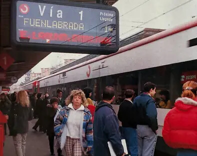
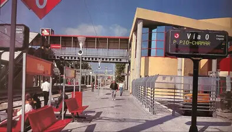
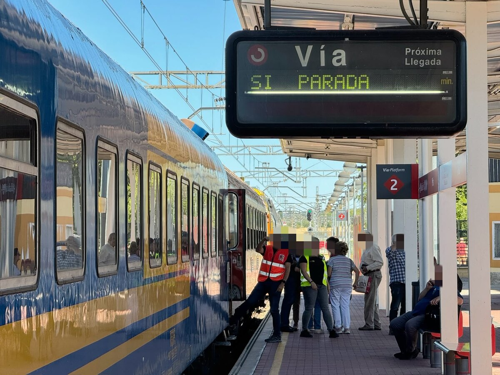
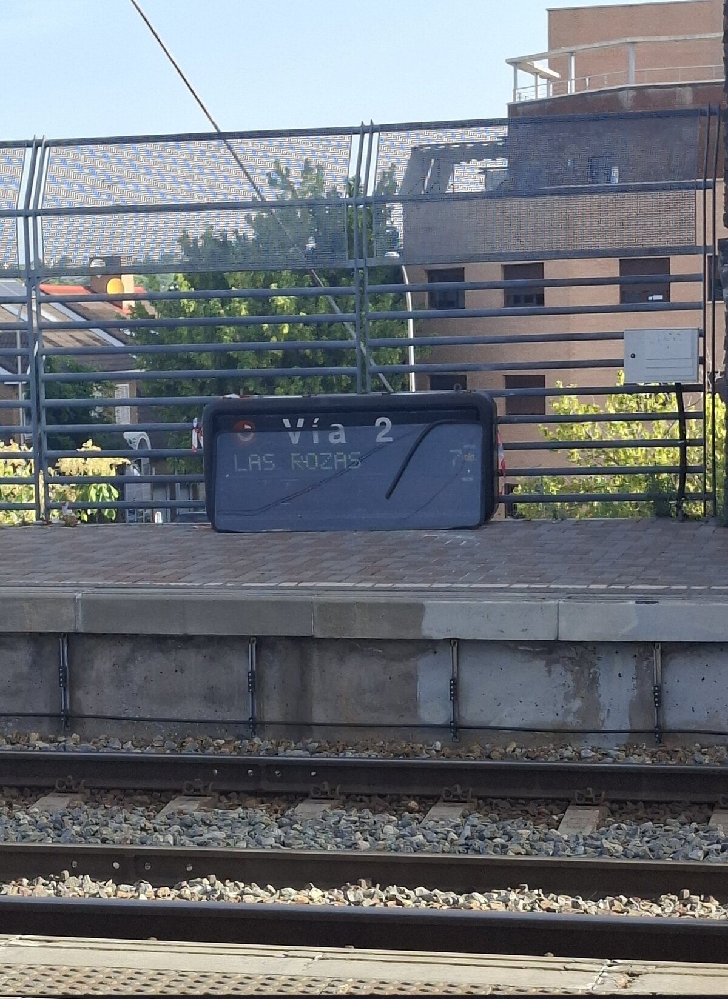
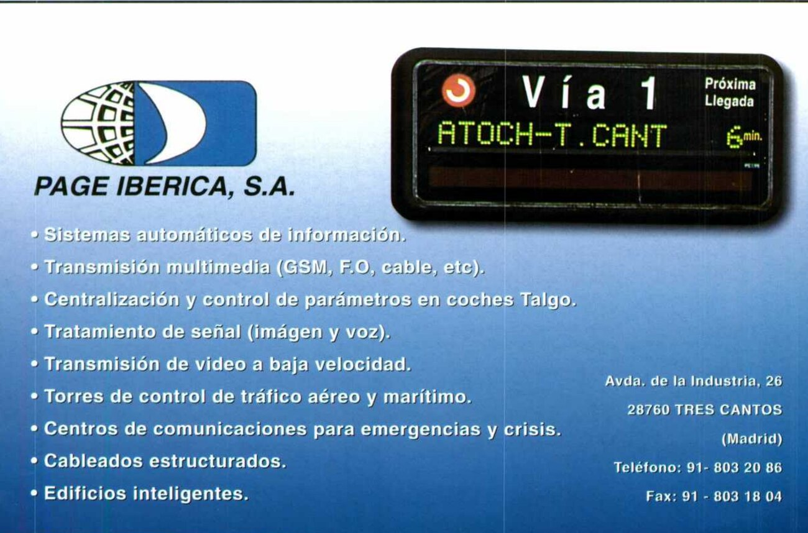

Reverse engineering of a **PAGE Ibérica PI-T100-M** flip-dot platform display,
installed from the mid-1990s in the stations of **RENFE Cercanías Madrid** to
announce the next train and the minutes until its arrival. They are being
taken down as stations are refitted, so the aims here are to preserve one,
document it and experiment with it.

The goal was to put arbitrary text on one from a modern computer, over its
original serial link, with no modification to the hardware or the firmware.

**It works.** Text goes onto a real panel over the original link. There is also
an [ESP32 controller](controller/) that replaces the sign's upstream controller
outright, and [a web replica](https://oierlauzi.github.io/renfe-flipdot-re/)
for anyone without a panel of their own.



The unit salvaged for this project, driven by the ESP32 in
[controller/](controller/).

## Español

Ingeniería inversa de un teleindicador **PAGE Ibérica PI-T100-M**, de los que se
instalaron en las estaciones de **RENFE Cercanías Madrid** a mediados de los 90.
El proyecto tiene el fin de preservar, documentar y experimentar.

El objetivo era enviar texto arbitrario al panel desde un ordenador moderno, a
través del enlace serie existente, **sin modificar el hardware ni el software**.
Funciona. También hay un [controlador ESP32](controller/) que sustituye al
equipo que gobernaba el cartel, y
[una réplica web](https://oierlauzi.github.io/renfe-flipdot-re/).

Este proyecto se documenta en **inglés**: es el idioma en el que estoy
acostumbrado a programar, y hacerlo en otros me resulta inconsistente.

## In service, and after



*Vía Libre*, March 1997, photographed by Luna. The dark strip under the text is
the LED row that scrolled the stations the train would call at.

<table>
<tr>
<td width="50%"></td>
<td width="50%"></td>
</tr>
<tr>
<td><b>Móstoles, 1997.</b> <a href="https://www.facebook.com/groups/574304876033372/permalink/4106013116195846/">From a Facebook post</a></td>
<td><b>Villalba, 1997.</b> <a href="https://www.facebook.com/groups/574304876033372/permalink/4097551237042034/">From a Facebook post</a></td>
</tr>
<tr>
<td></td>
<td align="center"></td>
</tr>
<tr>
<td><b>Pitis, 2026.</b> A few months before it came down, with the <i>Tren de los 80</i> alongside</td>
<td align="center"><b>Being disposed of.</b> Aravaca, <a href="https://x.com/David_82C/status/2069312279259062477">photographed by @David_82C</a></td>
</tr>
</table>

Mounting varied by station: under the canopy, or on a pole. Thirty years
separate the top row from the bottom one.

Flip dots are mechanical and hold their last message with no power, which is why
the firmware has a switch for whether to blank the panel on reset.

## The manufacturer, 1997



PAGE Ibérica's own advertisement in *Vía Libre*, March 1997. The line fits 16
characters, like this unit, and the Tres Cantos street address is the one on its
chassis plate.

## The font

All 256 glyphs, extracted from the ROM and rendered flip-dot style. It is IBM
CP437, with `ñ` and `Ñ` quietly duplicated into the lower half so they survive a
7-bit serial link.


## Putting text on it

```sh
pip install pyserial
tools/say.py CHAMARTIN            # one line onto the panel
tools/say.py                      # or type lines interactively
tools/say.py --fill               # every dot on
```

That needs a 4-wire RS-422 adapter and four wires.
[docs/2-talking-to-it.md](docs/2-talking-to-it.md) has the wiring and the
first-power-up procedure.

## Where to start

[**docs/**](docs/) is written to be read in order, from what the device is to
how it drives its dots. The first three files are enough to put text on a panel.

| | |
| --- | --- |
| [docs/](docs/) | The documentation, in reading order |
| [hardware/](hardware/) | Parts, boards, connectors, photographs |
| [controller/](controller/) | The ESP32 firmware that replaces the original controller |
| [web-replica/](web-replica/) | A browser replica of the display, [live here](https://oierlauzi.github.io/renfe-flipdot-re/) |
| [tools/](tools/) | Scripts: drive a panel, emulate the firmware, read the ROM |
| [original/](original/) | The ROM dump. Ground truth, never edited |
| [src/](src/) | Annotated assembly that rebuilds the ROM byte for byte |
| [ghidra/](ghidra/) | The symbol table and the script that applies it |
| [TODO.md](TODO.md) | The questions that stayed open |

## Licence

[MIT](LICENSE) for the documentation, the tools and the code. The original
firmware in [original/](original/) belongs to its authors and is included only
for interoperability research and preservation. The same goes for the
photographs in [hardware/photos/in-service/](hardware/photos/in-service/) and
the advertisement above, which are other people's work, reproduced here with
credit for the same reason.

This is an unofficial fan project, not affiliated with, endorsed by or sponsored
by RENFE, PAGE Ibérica or Telenorma. Trademarks and logos shown belong to their
owners and are used only to identify the hardware being documented.
