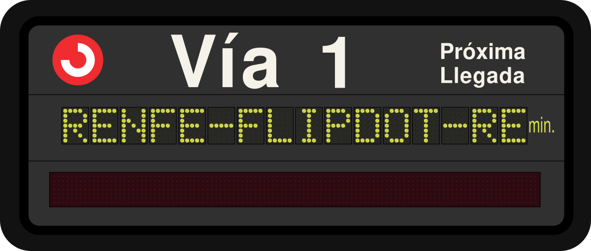
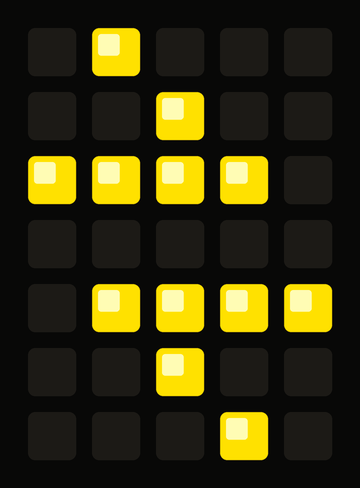
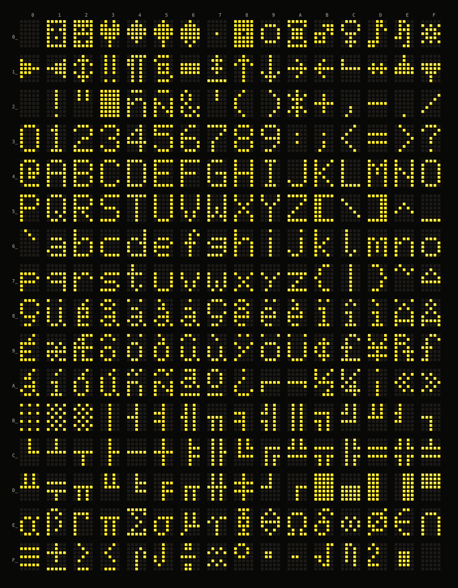

Reverse engineering of a **PAGE Ibérica PI-T100-M** flip-dot platform display,
as used in RENFE Cercanías stations, for preservation and play.

**Goal:** drive arbitrary text onto the panel from a modern host, over the
existing serial link, with **no hardware or software modification**.

In addition, [an online replica of the display](web-replica/) has been added to view
custom messages. 

I document this project in **English**: it's the language I'm used to
developing software in, and working in other languages has proven
inconsistent for me.

## Español

Ingeniería inversa de un teleindicador modelo **PAGE Ibérica PI-T100-M**. Este
modelo de pantalla se instaló en las estaciones de **RENFE Cercanías** a
mediados de los 90. El proyecto tiene el fin de preservar, experimentar y 
divulgar.

**Objetivo:** enviar texto arbitrario al panel desde un ordenador moderno, a
través del enlace serie existente, **sin modificar el hardware ni el software**.

Además, se dispone de [una réplica web del teleindicador] que se puede 
configurar para mostrar mensajes arbitrarios. 

Este proyecto se desarrolla en **inglés**: es el idioma en el que estoy
acostumbrado a programar, y desarrollar en otros idiomas me resulta
inconsistente.

## The device

| | |
| --- | --- |
| Model | PAGE Ibérica PI-T100-M ("MAESTRA" — master unit) |
| Electronics | **Telenorma** (Telefonbau und Normalzeit, Frankfurt) — logo on the motherboard, EPROM labelled `TELENORMA 18 JUN 96` |
| Display | 16 characters, 5x7 dots each (80x7 = 560 dots), 100 mm high |
| CPU | OKI MSM80C85AH (Intel 8085 clone) |
| Firmware | 32 KiB M27256 EPROM, 12.3 KiB used, version `AK0052.139U1` |
| Peripherals | M81C55-5 (256 B RAM + I/O + timer), M82C51A-2 USART |
| Interface | DB37, 4 conductors, opto-isolated (6N139) |
| Power | 24 VDC |

Full details in [docs/device.md](docs/device.md).

## Spotted in the wild

These units were installed across Cercanías Madrid starting in the **mid-1990s**
and are being **phased out during the 2020s** as stations are refitted with
modern LED/LCD signage. Mounting varies by station: some are **hung from the
platform marquee/ceiling**, others are **mounted on top of a pole**. Photos
below (Google Maps contributions) show the "Vía" next-arrival displays in
service at several stations:

| | | |
| --- | --- | --- |
| [](https://maps.app.goo.gl/SgD5UcXEt2scQfJP6) | [](https://maps.app.goo.gl/4AjHZ317e6zEZWLX6) | [](https://maps.app.goo.gl/Z3yJGkftK173W16y9) |
| Tres Cantos | Pitis | Galapagar-La Navata |
| [](https://maps.app.goo.gl/wM6Yq13YrQxSNZAG7) | [](https://maps.app.goo.gl/gkyVJaivqFrVrPYh8) | [](https://maps.app.goo.gl/yveuFPEbi5sjoSSv5) |
| Delicias | Cantoblanco Universidad | Collado Mediano |

## Character font

All 256 glyphs of the panel's 5x7 font, extracted straight from the ROM and
rendered flip-dot style. See [docs/font.md](docs/font.md) for the derivation
and [tools/extract_font.py](tools/extract_font.py) (`--png`) to regenerate it.



## Status: working

Arbitrary text goes onto a real panel, over the original link, with no hardware
modification. A DSD TECH SH-U11 USB-RS-422 adapter wired green/yellow to the
display's receive pair and blue/red to its transmit pair, running
[tools/bringup.py](tools/bringup.py):

```
[quiet]   silent. Correct -- the unit replies, it never announces.
[address] address 1 (GS byte 0x31) answers
[demo]    version : AK0052.139U1
          cursor  : row 0, col 0
          writing 'HOLA MUNDO'  -> ACK
          read back: 'HOLA MUNDO' -- MATCHES
```

Then, for everyday use, [tools/say.py](tools/say.py):

```sh
tools/say.py CHAMARTIN            # one line onto the panel
tools/say.py                      # or type lines interactively
tools/say.py --fill               # every dot on
```

| Area | State |
| --- | --- |
| ROM dump | Two independent reads, identical SHA-256, provenance recorded |
| Disassembly | Reassembles byte-for-byte identical to the ROM |
| Memory and I/O maps | Complete |
| Character font | All three glyph tables decoded |
| Physical layer | Opto-isolated 4-wire RS-422; wiring and polarity traced |
| Command protocol | Fully mapped and exercised on the unit |
| Flip-dot drive | Decoded: encoded address, shift clock, data, 74 bits per character |
| Remaining | DB37 pin numbers, the switch-to-port mapping, handler C's frame layout — see [TODO.md](TODO.md) |

## Key findings

* The external link is **opto-isolated 4-wire RS-422** — two TI SN75176BP
  transceivers and three 6N139 optocouplers on the interface board. This unit runs
  **1200 baud, 7 data bits, even parity, 1 stop, at display address 1**; baud rate
  and character format are both DIP-switch selectable across a 300-9600 ladder.
* **Three receive protocols, not one.** DIP switch port C bit 5 selects between the
  ASCII command set and an unrelated binary protocol at a hardwired 9600 8E1; port
  A bit 6 then picks between a simple delimited-text handler and the full command
  set.
* **The command set is a small terminal.** A unit is selected with `GS <addr>`
  (`0x7F` broadcasts), then accepts cursor positioning, erase, block-write and
  query commands, and answers with real data:

```
GS '5' SUB           -> AK0052.139U1 + the unit's configuration block
GS '5' TAB           -> cursor row and column
GS '5' STX HOLA ETX  -> ACK '5'      (acknowledged, with address)
GS '9' SUB           -> nothing      (wrong address, stays silent)
```

* **`ACK` means stored, not displayed.** A selected unit never repaints, so `RS`
  is what commits an update. Overflow is detected and `NAK`ed with a printable
  error code rather than silently truncated.
* **The panel is driven serially, not as a matrix.** Characters mount in pairs on
  carrier boards hanging off a shared 26-conductor bus, addressed by an encoded
  6-bit position rather than a dedicated select line, with a shift clock and a data
  line carrying 74 bits per character. Each carrier's six address switches match
  the firmware's 6-bit field exactly.
* **The font is CP437**: 256 glyphs of 5x7 at ROM `0x1C0D`, indexed directly by
  character code, one byte per column, bit 0 = top row. `text.encode("cp437")`
  works, with two exceptions — `0x24` and `0x25` are `ñ` and `Ñ`, not `$` and `%`,
  duplicated there so they survive a 7-bit link.
* **The display computes nothing.** No arithmetic on message content, no timer,
  no countdown. The upstream controller sends the whole line and re-sends it as
  the ETA changes.
* The firmware is a **generic multi-panel build**: 13 panel drivers behind 32
  switch settings, a configuration block reported over the wire, and several
  build-time options frozen into the image as always-taken tests.

## Layout

```
original/    Pristine captures from the device. Never edit. Checksummed.
docs/        Reverse-engineered understanding - the real product
hardware/    Chips, PCBs, connectors, PSU, photos
ghidra/      symbols.csv (source of truth for names) + scripts + frozen exports
src/         Annotated 8085 assembly, aiming at a byte-exact rebuild
tools/       Standalone scripts (font extraction, ROM inspection)
notes.md     Dated lab notebook - every experiment, including the failures
web-replica/ Browser replica of the display
```

## Quickstart

```sh
make                # list targets
make check          # verify the ROM dump and the symbol table
make font           # render all 256 glyphs
make font-map       # regenerate docs/font-map.png
make verify         # reassemble src/ and prove it matches the ROM
make disasm         # regenerate src/firmware.asm from the ROM and symbols.csv
make bringup-selftest   # exercise tools/bringup.py against the emulator
```

To browse the firmware without installing Ghidra, grep the frozen exports in
[ghidra/export/](ghidra/export/). To do real work on it, see
[ghidra/README.md](ghidra/README.md) — the import settings matter, because every
address in the docs depends on them.

## Conventions

* Firmware locations are cited by **address** as well as by name, so the
  documentation survives a re-import. Names come from
  [ghidra/symbols.csv](ghidra/symbols.csv).
* Memory addresses and I/O ports are different spaces on the 8085 and are always
  labelled as such.

## Safety

Flip-dot coils expect **short pulses**. Leaving one energised will overheat and
can destroy it — relevant to any experiment that drives the panel directly
instead of through this firmware. See
[docs/flipdot-interface.md](docs/flipdot-interface.md).

## Licence

[MIT](LICENSE) for the documentation, tools and any code here. The original
firmware in [original/](original/) is the property of its authors and is included
solely for interoperability research and preservation.

This is an unofficial fan project, not affiliated with, endorsed by, or
sponsored by RENFE, PAGE Ibérica, or Telenorma. Any trademarks, logos, and
brand names mentioned or shown are the property of their respective owners,
used here only to identify the hardware being documented.
