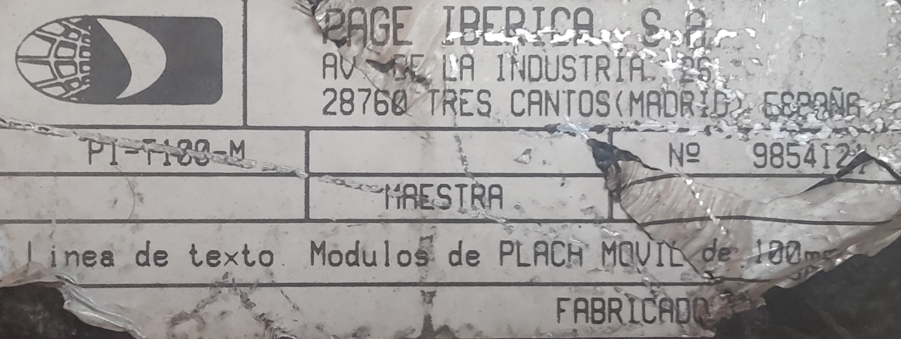

# 1. The device

A single-line flip-dot sign that hung over a RENFE Cercanías platform. It shows
the destination of the next train and how many minutes away it is.

## What the label says

From the chassis sticker:

| Field | Value |
| --- | --- |
| Manufacturer | PAGE Ibérica, S.A., Tres Cantos (Madrid) |
| Model | PI-T100-M |
| Serial | `985412?`, last digit torn off |
| Role | MAESTRA, Spanish for master |
| Description | "1 línea de texto. Módulos de PLACA MÓVIL de 100 mm" |

"Placa móvil" means moving plate, which is this flip-dot panel. The `-M` suffix
matches "maestra". The firmware reports its own version as `AK0052.139U1`.

## Geometry

| Property | Value |
| --- | --- |
| Characters | 16 |
| Character cell | 5 dots wide by 7 high |
| Total dots | 80 x 7 = 560 |
| Character height | 100 mm |

## Dating

The EPROM carries a sticker reading `TELENORMA 18 JUN 96`, so the firmware was
programmed on 18 June 1996. The DC-DC converter has `9601` in its PCB marking
and a handwritten QA sticker reading `30-01-9?`. The chassis plate gives a serial
but no date. Everything agrees on a mid-1990s build.

## Who built it

Two marks say the electronics are German, not Spanish: the EPROM sticker, and
the Telenorma logo on the motherboard silkscreen. All three boards carry
German-industrial part numbers of the form `300-48.0216.5586`.

**Telenorma** descends from Telefonbau und Normalzeit of Frankfurt, literally
"telephone construction and standard time". Besides telephone systems the firm
built public and station clock installations. It later became part of Bosch
Telecom.

So Telenorma designed the electronics and wrote the firmware, and PAGE Ibérica
supplied the sign around them: the enclosure, the flip-dot panel and the
fluorescent tube. The chassis plate reads `FABRICADO`, which fits either
manufacture under licence or assembly around bought-in boards.

The firmware agrees. It is not a RENFE one-off but a generic display terminal:
ASCII control codes, addressing, framing, acknowledgements, an identify command,
and 13 different panel drivers selected by switches. Near-identical hardware
probably survives under Telenorma part numbers, which is a much wider search
than Spanish rail sources.

## In the station

The unit is the text line of a platform sign assembly:

| Element | Content |
| --- | --- |
| `Vía N` indicator above | Which platform. Not part of this unit, which is one line of text |
| Flip-dot line (this unit) | Destination, and minutes until arrival |
| Vinyl sticker to its right | The fixed word `min` |
| LED matrix below (not recovered) | Scrolling list of calling stations, and notices |
| Fluorescent tube along the bottom | Lights the panel at night |

Because `min` is a sticker rather than rendered text, the line is laid out with
the destination on the left and the number pushed to the right-hand end. That is
a convention of whatever drives the sign, not something the sign knows about.

Three assemblies using this generation of display have been seen in service:
single-sided platform signs, double-sided ones, and station-wide boards in the
concourse that stack two to four rows of 20 characters. The 20-character rows
show that the line width varies between members of the family, which fits a
firmware that treats the panel as a configurable option.

Photographs of complete assemblies, in service and being taken down, are in
[../hardware/photos/in-service/](../hardware/photos/in-service/).

### What the press said at the time

*Vía Libre* ran a feature on Cercanías passenger information in March 1997,
with a section headed "Teleindicadores de andén electromagnéticos". José María
Navarro, of PAGE Ibérica, describes the sign:

> En los andenes anuncia en un panel, con una línea de excitación
> electromagnética, qué tren va a llegar y cuántos minutos falta para su
> detención en la parada, y en otra línea de texto móvil, de diodos,
> información sobre las estaciones sucesivas donde el tren va a tener las
> siguientes paradas.

One electromagnetic line for the train and the minutes, and a second line of
moving text, made of diodes, for the stations it will call at. That is the
assembly above, described by the manufacturer, and it settles that the two rows
are different technologies rather than one panel.

The rest of the article is worth reading for anyone building a controller or
looking for more of these units:

* The data comes from centralised traffic control. If that link breaks, the
  system can be driven from the Cercanías control centre, or from **the computer
  installed at each station**. That computer is the upstream controller this
  unit sits and waits for.
* The links between the station terminals, the control centre and traffic
  control run over **telephone quads** and fibre. A quad is four conductors, and
  four conductors is what is populated on this unit's DB37.
* Every part of the system is described as off-the-shelf, bought on the open
  market to keep maintenance easy. The ROM agrees: an 8085, two 8155s, an 8251
  and some Darlington arrays, with nothing custom in sight.
* PAGE Ibérica's system was installed on lines C-5 (Móstoles, Atocha,
  Fuenlabrada), C-8 (Atocha, Villalba) and C-10 (Villalba, Príncipe Pío, Atocha,
  Chamartín), and was going in on C-4 and C-1. **Other cities had other
  suppliers**: AEG-Matra in Málaga and Valencia, Electrans in Barcelona, Ikusi
  in Bilbao. So an electromagnetic sign from outside Madrid is probably somebody
  else's design, and nothing here need apply to it.

## The sign computes nothing

This is the most important thing to know before writing a controller.

The unit does no arithmetic on message content. Nothing formats a number into
characters, there is no minute timer, and nothing counts a countdown down. The
countdown is pushed from upstream, one whole line at a time. Something re-sent
that line every minute.

What is local to the unit:

* Glyph rendering and the flip-dot drive.
* The display effects selected by the `BEL` command.
* Serial addressing, framing and error reporting.

The only digit arithmetic in the ROM belongs to an optional clock board, which
puts `HHMM` into the first four characters. It never touches the text a host
sends, and it is not known whether this unit was fitted with that board at all.

A replacement controller therefore sends all 16 characters, digits included, and
sends them again when the number changes.

## What is inside

Three boards, one job each, plus the panel.

| Board | Job |
| --- | --- |
| Motherboard | The computer: CPU, RAM, EPROM, serial chip, configuration switches |
| Daughter 1 | Turns the serial chip's logic levels into an isolated RS-422 line |
| Daughter 2 | Drives the flip-dot panel |

Swapping daughter 1 changes the physical layer and swapping daughter 2 changes
the panel type, which is what the firmware's 13 panel drivers are for. The host
link enters at the DB37 connector and stops at daughter 1. Nothing on the
daughter-2 ribbon is a controller; everything down there is display.

| Part | Where | Role |
| --- | --- | --- |
| OKI MSM80C85AH | Mother | CPU, an Intel 8085 clone at 3.072 MHz |
| OKI M81C55-5 | Mother | The only RAM, 256 bytes, plus the switch inputs and the baud clock |
| OKI M82C51A-2 | Mother | USART, the whole external interface |
| ST M27256F1 | Mother | 32 KiB EPROM, 12.3 KiB used |
| 2 x TI SN75176BP | Daughter 1 | RS-422 differential transceivers, one per pair |
| 3 x HP 6N139 | Daughter 1 | Optocouplers, the isolation barrier |
| 3 x ULN2003A | Daughter 2 | 21 Darlington current sinks for the coils |
| OKI M81C55-5 | Daughter 2 | The flip-dot interface ports |

Full parts list, board photographs and the power arrangement are in
[../hardware/](../hardware/).

## Power

24 V DC in, through two mains feeds that are separate: one for the 24 V supply,
one for the fluorescent tube and its ballast. The panel is bistable and readable
in daylight, so the tube is only a night-time reading light.

**The tube's ballast is inside the enclosure.** Mains is therefore live in two
places in there, and the ballast is a large noise source sitting next to the
logic and the serial interface. Work with the tube feed disconnected.
