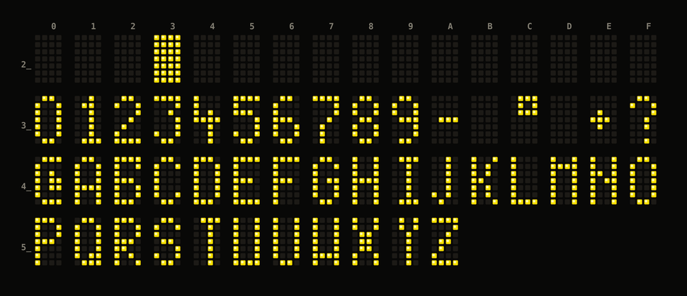
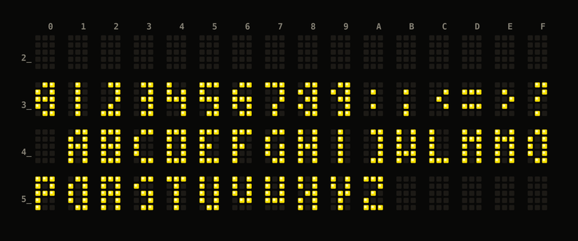

# Glyph tables

Regenerate the rendering below with:

```sh
python3 tools/extract_font.py                       # every glyph, as blocks
python3 tools/extract_font.py --ascii --range 0x30-0x39
python3 tools/extract_font.py --json > font.json
```

The tool re-derives the table base and geometry from the ROM on every run and
fails loudly if either is wrong, so it doubles as a regression check on the
claims below.

## Format

| Property | Value |
| --- | --- |
| ROM range | `0x1C0D-0x210C` (1280 bytes) |
| Entries | 256, indexed **directly by character code** (`glyph = 0x1C0D + code*5`) |
| Bytes per glyph | 5 (one per column, left to right) |
| Bits per column | 7 — **bit 0 = top row**, bit 6 = bottom row, bit 7 unused |

Bit 7 is clear in all 1280 bytes, which is what makes the geometry certain
rather than assumed.

Column-major with LSB at the top means a glyph is read as:

```
byte:   b0   b1   b2   b3   b4
row 0:  b0.0 b1.0 b2.0 b3.0 b4.0
row 1:  b0.1 b1.1 b2.1 b3.1 b4.1
  ...
row 6:  b0.6 b1.6 b2.6 b3.6 b4.6
```

Worked examples:

```
'0' = 0x30  @ 0x1CFD   3e 41 41 41 3e      'A' = 0x41  @ 0x1D52   7e 09 09 09 7e
      .###.                                      .###.
      #...#                                      #...#
      #...#                                      #...#
      #...#                                      #####
      #...#                                      #...#
      #...#                                      #...#
      .###.                                      #...#

' ' = 0x20  @ 0x1CAD   00 00 00 00 00      'B' = 0x42  @ 0x1D57   7f 49 49 49 36
      (blank)                                    ####.
                                                 #...#
                                                 #...#
                                                 ####.
                                                 #...#
                                                 #...#
                                                 ####.
```

## Code page: IBM CP437, with two substitutions


Regenerate the map with `make font-map`.

**The encoding is IBM Code Page 437.** Every region of the table matches, which
is what makes this certain rather than a guess:

| Range | CP437 content | Matches |
| --- | --- | --- |
| `0x01-0x0F` | smileys, card suits, `•`, `♪`, `♫`, `☼` | yes |
| `0x10-0x1F` | `►◄↕‼¶§▬↨↑↓→←∟↔▲▼` | yes |
| `0x80-0x9F` | `Çüéâäàåçêëèïîì ÄÅÉæÆôöòûùÿÖÜ¢£¥₧ƒ` | yes |
| `0xA0-0xAF` | `áíóúñѪº¿⌐¬½¼¡«»` | yes |
| `0xB0-0xDF` | shading and box drawing | yes |
| `0xE0-0xEF` | `αßΓπΣσµτΦΘΩδ∞φε∩` | yes |
| `0xF0-0xFE` | `≡±≥≤⌠⌡÷≈°∙·√ⁿ²■` | yes |

Spot-checked against the raw bytes: `0xA5` renders an unmistakable **Ñ**, `0xA8`
an inverted `¿`, `0xAD` an inverted `¡`, and `0x82` an `é`.

### What to send for Spanish text

| Character | Byte | | Character | Byte |
| --- | --- | --- | --- | --- |
| `Ñ` | `0xA5` | | `á` | `0xA0` |
| `ñ` | `0xA4` | | `í` | `0xA1` |
| `¿` | `0xA8` | | `ó` | `0xA2` |
| `¡` | `0xAD` | | `ú` | `0xA3` |
| `é` | `0x82` | | `Ü` | `0x9A` |

In Python, `text.encode("cp437")` produces the right bytes directly.

### The two substitutions: `ñ` and `Ñ`, reachable over a 7-bit link

`0x24` and `0x25` are **not** `$` and `%`. They are **`ñ` and `Ñ`**, deliberate
duplicates of CP437's `0xA4` and `0xA5`, placed so that **stripping bit 7 lands on
the right glyph**:

```
0xA4 & 0x7F = 0x24      n-tilde
0xA5 & 0x7F = 0x25      N-tilde
```

That is the whole explanation, and it is not a coincidence of two arbitrary
positions: it is the *only* pair of characters Spanish cannot do without, put
exactly where a 7-bit link would deliver them.

The glyphs are redrawn rather than copied — same letters, different artwork:

```
    0x24  ñ       0xA4  ñ           0x25  Ñ       0xA5  Ñ
    .###.         .#.#.             .###.         .##.#
    .....         #.#..             .....         #..#.
    #.##.         .....             #...#         .....
    ##..#         ###..             ##..#         ##..#
    #...#         #..#.             #.#.#         #.#.#
    #...#         #..#.             #..##         #..##
    #...#         #..#.             #...#         #...#
```

The `0x2x` pair use a full-width tilde on row 0 with the letter below; the CP437
originals squeeze a smaller tilde into rows 0-1. In each pair the letter body is
identical — compare the raw bytes, where `0x25` is `7c **09 11 21** 7c` against
`0xA5`'s `7a **09 11 22** 79`.

`0x24` and `0x25` differ from each other exactly where lowercase differs from
uppercase: `0x24`'s body is an `n` shoulder-and-stem, `0x25`'s carries the
diagonal that both `N` glyphs show.

**Two findings agree**, arrived at independently:

1. The firmware masks with `ANI 0x7F` wherever it takes a parameter — the `GS`
   address at `0x1060`, `VT`'s row and column at `0x0CD0`/`0x0D00`, `EOT`'s
   sub-mode at `0x1123`.
2. The font table duplicates precisely `ñ` and `Ñ` at their bit-7-stripped
   positions.

A 7-bit link physically cannot carry `0xA5`. The duplicates are not a curiosity,
they are what makes the display usable in Spanish over a link that is not 8-bit
clean.

**This unit runs a 7-bit link**, so the duplicates are exactly what it needs:
1200 baud, 7 data bits, even parity, 1 stop
([dip-switches.md](dip-switches.md#this-units-configuration)). The design is not
specific to this installation, though — the character format is itself a switch,
so the ROM carries the duplicates for whichever units in the family are set that
way.

### CP437's gap: uppercase accented vowels

Worth knowing before writing station names, because they are usually uppercase.
CP437 carries the *lowercase* accented vowels (`á í ó ú` at `0xA0-0xA3`) but of
the uppercase ones only **`É` (0x90)**, plus `Ä Å Ö Ü Æ` and `Ñ (0xA5)`.

**There is no `Á`, `Í`, `Ó` or `Ú`.** So `CHAMARTÍN` cannot be sent as written;
it has to be `CHAMARTIN`, or use one of the two substitute glyphs. `Ñ` and `É`
are the two that do work — fortunately the two Spanish most needs.

Note this is a *different* gap from the one `0x24`/`0x25` fill. Those two exist so
that `ñ` and `Ñ` survive a 7-bit link; they do nothing for the missing accented
capitals, which simply cannot be displayed at all.

`tools/pit100.py` refuses to encode a character with no glyph rather than
silently sending the wrong one, and offers `fold=True` to drop the impossible
accents.

**Consequence for a controller:**

* Do not send `$` or `%` expecting them to appear — they are `ñ` and `Ñ`.
* Over a **7-bit link**, send `ñ` as `0x24` and `Ñ` as `0x25`; `0xA4`/`0xA5` will
  have their top bit stripped and arrive at those codes anyway, so either works.
  `tools/pit100.py`'s `encode(seven_bit=True)` does the mapping explicitly.
* Fold or avoid uppercase `Á Í Ó Ú`, which have no glyph at any code point.
* Everything else in `0x20-0x7E` matches ASCII as far as the glyph map shows.

Two firmware references worth following if the table is ever indexed
differently: `LXI HL,0x1C0D` (3 sites) and `LXI HL,0x1C5D` (3 sites, = table
base + 16 entries).

## The ROM holds three glyph tables

Worth knowing before any statement about "the font": there are three, for different
panel types, and they share nothing.

| Table | Address | Geometry | Codes | Indexing |
| --- | --- | --- | --- | --- |
| [5x7](#code-page-ibm-cp437-with-two-substitutions) | `0x1C0D-0x210C` | 5 cols x 7 rows | all 256 | direct: `base + code*5` |
| [4x7](#the-third-table-at-0x23cf--4-x-7) | `0x23CF-0x24BA` | 4 cols x 7 rows | `0x20-0x5A` | linear search, 4-byte stride |
| [3x5](#the-second-character-set-at-0x2692--3-x-5) | `0x2692-0x2914` | 3 cols x 5 rows | `0x20-0x5A`-ish | pointer table, packed bits |

Only the 5x7 table is used by **this** unit (panel type `0x11`).

### Is there a fourth?

Three independent searches, all negative:

1. **Every `LXI` immediate landing inside the ROM** — the only table bases are
   `0x1C0D`, `0x23CF` and `0x2692` (plus `0x1C5D`, which is `0x1C0D + 16 glyphs`).
2. **Runs of 48+ bytes with bit 7 never set**, the signature of a column-per-byte
   glyph table with 7 or fewer rows. Four runs exist: the two byte-per-column
   fonts, the `0x00DF-0x025E` zero padding, and a 64-entry halving table at
   `0x0092` (`i -> i/2`). Nothing else.
3. **Runs of 16+ consecutive words pointing into the ROM**, which is how the 3x5
   table was found. Only `0x2692` is real; the other two hits fall inside the
   halving table and the 5x7 glyph data and are coincidence.

Search 2 cannot see a *bit-packed* font — that is exactly how the 3x5 table evades
it — but search 1 and 3 cover that case, since a packed table needs either a base
address in an `LXI` or a pointer table. A fourth font would have to be reached by
some other means entirely.

## The third table at `0x23CF` — 4 x 7



Found from its reader rather than by scanning. `font_4x7_lookup` (`0x234B`):

```
0x234B  LXI  H,0x23CF
0x234E  MVI  A,0x20        ; first code
0x2350  CMP  B             ; wanted?
0x2354  INX  H x4          ; else step one 4-byte entry
0x2358  INR  A
0x2359  CPI  0x5B          ; ...up to 0x5A
0x235B  JNZ  0x2350
```

so **59 entries of 4 bytes, codes `0x20`-`0x5A`** — space through `Z`. That is
`0x23CF-0x24BA`, ending exactly where the panel driver at `0x24BB` begins.
`font_4x7_emit` (`0x2363`) then walks the four columns with `ANI 0x7F` (7 rows) and
`CMA` (active low).

**The columns are stored right to left.** Read left to right every asymmetric letter
comes out mirrored — `B`, `E`, `L`, `J` are unmistakable. Reversing the four bytes
gives correct glyphs, so the panel's shift register fills such that the
first-emitted column lands rightmost. `tools/extract_font.py --font 4x7` does the
reversal.

```
0x42 'B'  @0x2457   33 49 49 7f
          ####
          #..#
          #...
          ###.
          #..#
          #..#
          ###.
```

Character coverage: digits, `A-Z`, and a handful of punctuation — `#` at `0x23` is
the same solid block the 5x7 table uses for fill. No lowercase, no accents.

## The second character set at `0x2692` — 3 x 5

The 5x7 table is not the only one. A **128-entry pointer table at `0x2692-0x2791`**,
indexed by a 7-bit character code, points into **`0x2792-0x2914`**: 43 entries of
**9 bytes each**. The region ends exactly where code resumes at `0x2915`.



Regenerate with `python3 tools/extract_font.py --alt --png docs/font-map-alt.png`.

### Layout

The consumer decodes the format, not the data. `alt_char_lookup` (`0x264F`) maps a
character to its entry; `shift_out_port_a` (`0x2661`) then clocks **exactly 30
bits, MSB first**, out of port A bit 7, and `clock_port_a` (`0x2680`) issues **10
blank clocks** after it.

| Property | Value |
| --- | --- |
| Entry | 9 bytes: a constant `03h`, then **two 4-byte groups** at offsets 1 and 5 |
| Bits used | 30 of each group's 32 — which is why the last byte never uses bits 0-1 |
| Within a group | **3 columns**, each occupying a **10-bit field** |
| Glyph | the **top 5 bits** of each field — so the character is **3 wide x 5 tall** |

```
0x45 'E'  @0x284F   03 fb ea 58 84 fb ea 58 84
          ###
          #..
          ##.
          #..
          ###
```

### It is a 3 x 5 cell, not 6 x 7

Variants of this display are reported to use 6x7 cells with a blank column between
characters. This ROM's alternate set is not one of them.

Every 6x7 arrangement was tried — both bit orders, all window offsets within the 30
bits, column- and row-major, each group alone and the two combined side by side or
interleaved — and all render as noise. Template-matching `H L T E I O U` against
canonical shapes across widths 3-10 and heights 4-12 scored **3 wide** highest by a
clear margin, and the 3x5 reading then produces all 42 characters legibly, including
the awkward ones: `K M N W` and the punctuation `: ; < = > ?`.

So this ROM drives a **3 x 5** cell. A 6x7 variant would be a different panel type
with its own table — consistent with the firmware treating panel type as a
first-class variable throughout. This set belongs to types `0x10`/`0x12`, reached at
`0x2915`, **not** to this unit's `0x11`, which uses the 5x7 table.

### Which characters exist

86 of the 128 codes share a blank entry. The 42 that do not are exactly:

```
0123456789:;<=>?ABCDEFGHIJKLMNOPQRSTUVWXYZ
```

Digits, the punctuation completing `0x30-0x3F`, and the uppercase letters. No
lowercase, no accents — **not even `Ñ`**, which the 5x7 table goes out of its way to
provide twice. Whatever this panel is, it was not expected to show Spanish place
names with tildes.

### What is still open

* **The low 5 bits of each 10-bit column field.** They hold something close to a
  second copy of the glyph, offset by a row. A pre-shifted copy for a display whose
  characters are not aligned to the shift register would fit, but that is a guess.
* **Group B.** The second 4-byte group differs from the first for 36 of the 42
  characters. Both decode as valid-looking glyphs; which one the panel uses, and
  when, is not established.
* Why a character needs 80 clocked bits (2 x 30 data + 2 x 10 blank) to place a
  3 x 5 glyph.

## Relation to the physical display

The panel is 16 characters of 5x7 dots, i.e. 80x7 = 560 flip-dots, matching a
5-byte-per-character glyph exactly with no inter-character gap stored in ROM.
Whether the hardware inserts a physical gap between characters is a mechanical
question — see [hardware/pcbs.md](../hardware/pcbs.md).
